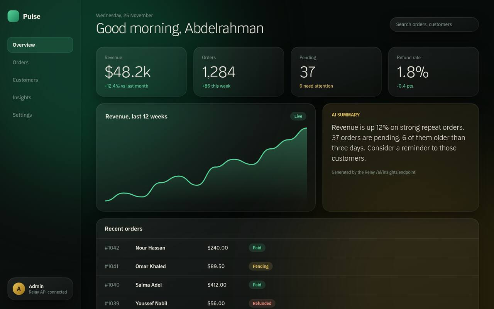
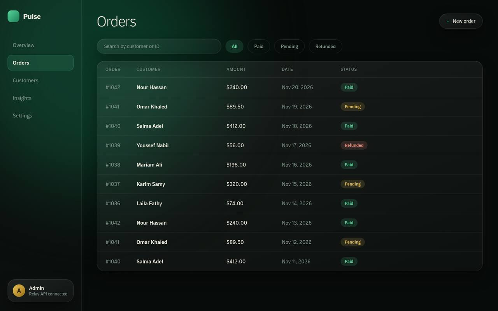
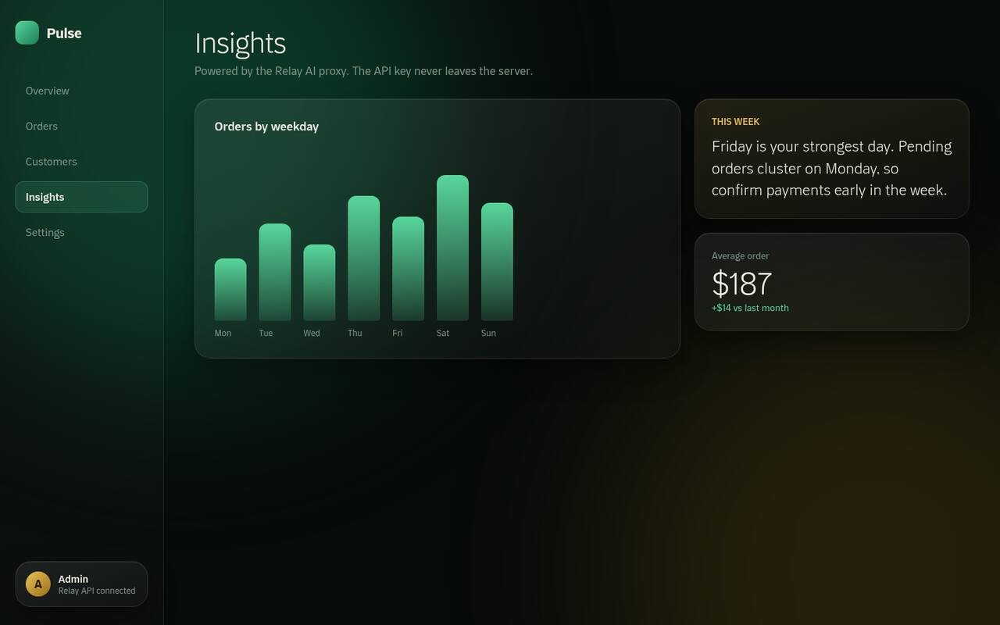
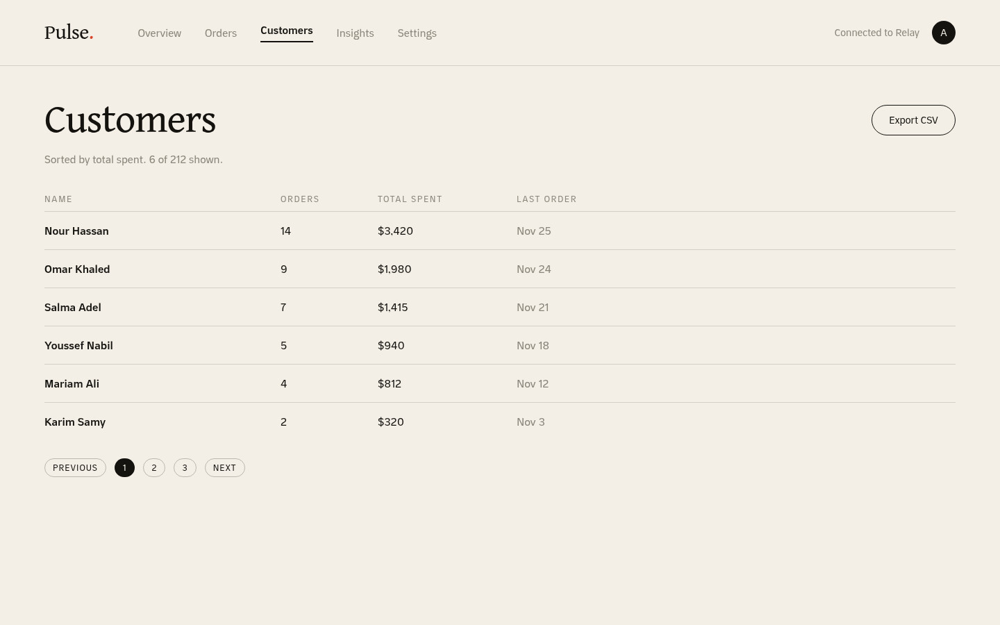
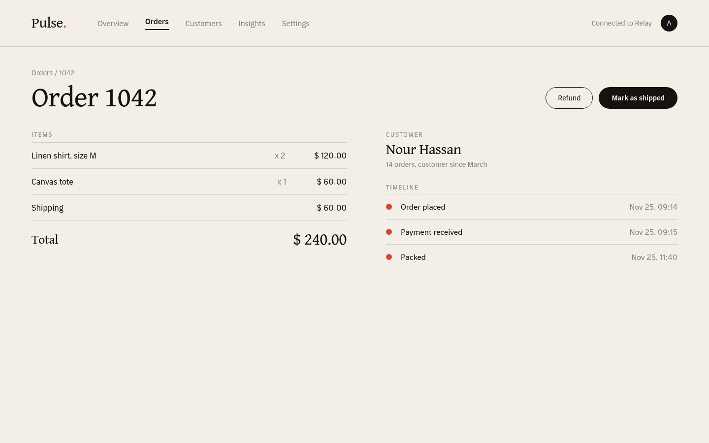
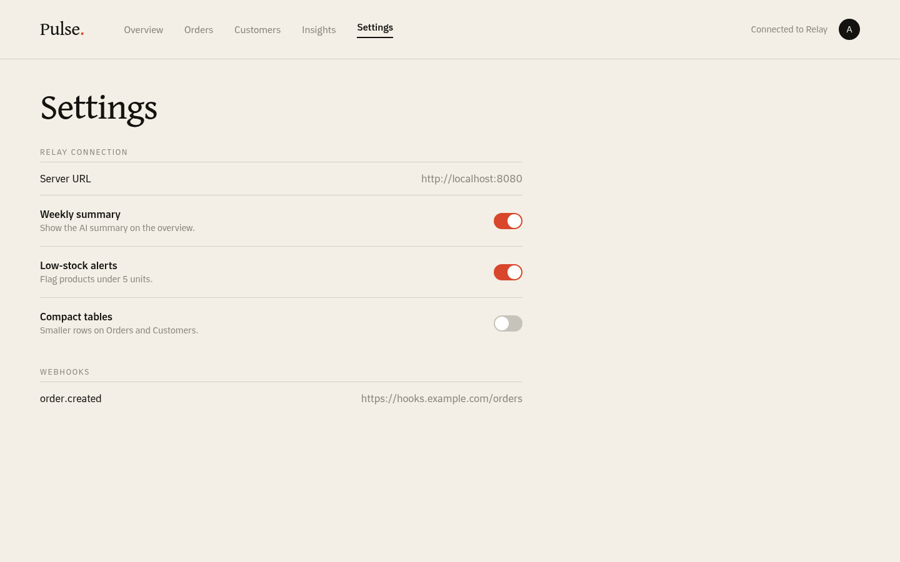

# Pulse: Flutter Web admin dashboard

A responsive admin dashboard built with **Flutter Web** and **Dart**. Four screens (overview, orders, customers, settings), a real sign-in, read-only and admin roles, and a REST backend (**Relay**, separate repo).

**Tech:** Flutter, Dart, Flutter Web, Provider (one model per screen), REST client with token auth and silent re-login, server-side paging, fl_chart, shared_preferences, intl, responsive layout (rail or bottom bar), Material 3 light editorial theme (paper, ink, serif headings).

## Screens
- **Overview:** KPI cards, revenue chart with a 7, 14 or 30 day switch and a trend against the previous window, orders by status, top customers, recent orders, a pending-orders alert and an AI summary card.
- **Orders:** debounced search, status filter, sortable columns, paging, multi-select with bulk status change, CSV copy. Tap a row for the order detail: items, total, status change with rollback on failure, and a status timeline.
- **Customers:** infinite scroll, tag filter, sort by name, top spenders or most orders, add customer, customer detail with lifetime value and order list.
- **Settings:** currency, compact numbers, dense tables, rows per page and the pending alert threshold. Saved on the device.

## Architecture
```
lib/core/       PulseApi interface, RelayApi (http), SampleApi (in memory, same rules as the server)
lib/models/     Order, Customer, Stats, Paged, Settings
lib/state/      session, dashboard, orders, order detail, customers, settings (ChangeNotifier + Provider)
lib/pages/      login, shell, dashboard, orders, order detail, customers, customer detail, settings
lib/widgets/    status chip, KPI card, charts, empty and error states, page footer
test/           models, sample API, Relay client with mock HTTP, all state models, widgets
```
Screens never build their own HTTP clients. They get a `PulseApi` from the session, so the same screens run against Relay or against sample data. A viewer role is read-only in both.

## Run
```bash
# 1) start Relay (see the relay-dart-backend repo), then:
flutter pub get
flutter run -d chrome --dart-define=RELAY_URL=http://localhost:8080
# sign in with admin / admin123, or viewer / viewer123 for the read-only role
flutter test
flutter build web
```
No server? Choose "Open with sample data" on the sign-in screen.

## Honest status
- The code was written without running it on a device. Run `flutter analyze` and `flutter test` first.

## Screens






